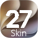

<h1 align="center">
  
  skin27
</h1>

>[!WARNING] 
>This is a build that I only built with a specific iPhone 6 on iOS 12.5.8. Even though it may not matter, please note that everything may not work depending on your specific iPhone model.

>[!Note]
>This repository is counted as finished. If there is any problems, please send them [here.](https://github.com/sandwich-makes-code/skin27/issues)

> [!NOTE]
> If you already have **SnowBoard** installed from a previous theme, uninstall **SnowBoard** in Cydia before running **Install .deb** so your new icons apply cleanly.

> [!note]
> Once you have installed this skin pack, you can change icons by holding down an app and drag it around to access Jiggle Mode, then double-tap your desired app icon you want to change quickly, in which you will access an icon switcher menu.

## Introduction
**Ever wanted to have the new Liquid Glass UI without sending your wallet to the god of debt?**
This repo aims to replicate the liquid feel for every iPhone that is, or above, a 6th generation that also has at least iOS 12 to 14. (precisely iOS 12.5.8 to 14.8.1)

## Installation Guide
**Your iPhone must have already been jailbroken by some jailbreaking tool and must have Cydia installed.**

### Steps
1. Open **Cydia** and install **`Filza File Manager`** (tap **Return to Cydia** when finished) and **`Batchomatic`** (tap **Restart SpringBoard** when finished).
2. Download the **`.deb` file** from [here](https://github.com/sandwich-makes-code/skin27/releases) and open it in **Filza**.
3. Tap the `.deb` file in Filza and tap **Install** (top right), then tap **Done** (or **Respring**).
4. Open **Cydia > Search**, tap the **Batchomatic** (steering wheel) icon next to the search bar, and tap **Install .deb**.
5. Tap **Proceed** and let your device respring into **iOS 27**!
